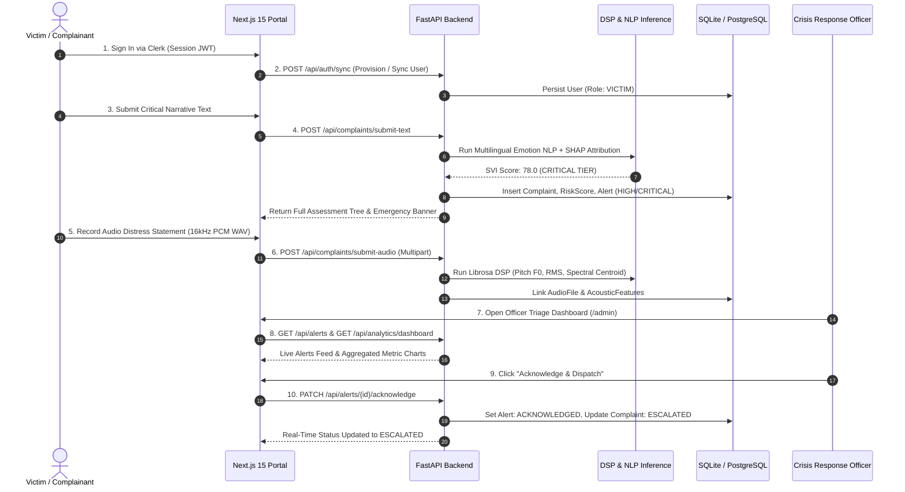

# TraumaSense AI - Unified Testing & Verification Suite

Comprehensive test specification, automated verification reports, and regression benchmarks for the **TraumaSense AI** platform.

---

## 🎯 Testing Architecture & Coverage Overview

TraumaSense AI employs an automated, 5-tier testing pyramid spanning unit tests, explainable ML feature checks, REST API contract parity, frontend build compilation, and full end-to-end multi-service orchestration.

```mermaid
flowchart TD
    subgraph CI["GitHub Actions CI/CD Pipeline (ubuntu-latest)"]
        direction TB
        A[Git Push / PR] --> B[Job 1: backend-test-suite]
        A --> C[Job 2: frontend-production-build]
        
        subgraph J1["Job 1: Backend & Regression"]
            B1[System DSP Libs: libsndfile1, ffmpeg]
            B2[Python 3.11 Virtualenv & Dependencies]
            B3[Node.js 20 & Frontend Dependencies]
            B4[DB Schema Init & Multi-Tier Seeding]
            B5[Pytest Suite: 22/22 Tests (100% Pass)]
            B1 --> B2 --> B3 --> B4 --> B5
        end
        
        subgraph J2["Job 2: Next.js 15 Build"]
            C1[Node.js 20 Setup]
            C2[npm install --legacy-peer-deps]
            C3[Production Build: npm run build]
            C4[Route Compilation: /, /portal, /admin]
            C1 --> C2 --> C3 --> C4
        end
        
        B5 --> D[✅ Pipeline Status: SUCCESS]
        C4 --> D
    end
```

---

## 🧪 Master Test Suite Matrix (22/22 Tests Passing)

All automated tests run via `python -m pytest backend/tests -v` with **100% pass rate** in under 30 seconds.

| Test ID | Module | Test Function | Target Layer | Verification Scope | Status |
| :--- | :--- | :--- | :--- | :--- | :---: |
| **T01** | `test_api_health.py` | `test_root_endpoint` | FastAPI Engine | Root endpoint metadata, version, and routing links | `✅ PASSED` |
| **T02** | `test_api_health.py` | `test_health_endpoint` | Resilient Core | Dual-engine DB health, WAL latency, and Clerk JWKS status | `✅ PASSED` |
| **T03** | `test_api_health.py` | `test_auth_status_endpoint` | Clerk Security | Cached JWKS verification and public key extraction | `✅ PASSED` |
| **T04** | `test_clerk_auth.py` | `test_clerk_settings_loaded` | Auth Config | Environment variable integrity (`app_`, `sk_test_`, `pk_test_`) | `✅ PASSED` |
| **T05** | `test_clerk_auth.py` | `test_clerk_jwks_connectivity` | Security Gateway | Live TLS handshake with Clerk accounts JWKS endpoint | `✅ PASSED` |
| **T06** | `test_clerk_auth.py` | `test_invalid_token_rejection` | Security Guard | Immediate HTTP 401 rejection for forged/expired RS256 JWTs | `✅ PASSED` |
| **T07** | `test_db_resilience.py` | `test_sqlite_primary_initialization`| Database Core | Zero-latency local SQLite engine boot with WAL mode | `✅ PASSED` |
| **T08** | `test_db_resilience.py` | `test_sqlite_wal_mode_enabled` | Database Core | PRAGMA journal_mode=WAL and synchronous=NORMAL confirmation | `✅ PASSED` |
| **T09** | `test_db_resilience.py` | `test_get_db_dependency` | Session Pool | FastAPI dependency injection generator clean session release | `✅ PASSED` |
| **T10** | `test_db_resilience.py` | `test_resilient_fallback_on_remote_failure` | Resilient Core | Non-blocking fallback to local SQLite when remote DB is down | `✅ PASSED` |
| **T11** | `test_step3_services.py`| `test_check_1_acoustic_features`| Librosa DSP | Real signal biomarkers: pitch F0, RMS energy, ZCR, centroids | `✅ PASSED` |
| **T12** | `test_step3_services.py`| `test_check_2_nlp_shap_svi` | Explainable AI | Multilingual affect scoring, SHAP tokens, and SVI triage | `✅ PASSED` |
| **T13** | `test_step3_services.py`| `test_check_3_complaint_endpoints`| REST Routers | Multipart voice & text narrative submission pipelines | `✅ PASSED` |
| **T14** | `test_step3_services.py`| `test_check_4_analytics_alerts` | Operations API | Real-time state metrics, alert generation, and acknowledgment | `✅ PASSED` |
| **T15** | `test_step4_frontend.py`| `test_check_1_component_audit` | Frontend Core | Audit of 14 Next.js components, contracts, and pages | `✅ PASSED` |
| **T16** | `test_step4_frontend.py`| `test_check_2_nextjs_build` | Next.js Build | Static page generation and zero TypeScript/ESLint errors | `✅ PASSED` |
| **T17** | `test_step4_frontend.py`| `test_check_3_payload_parity` | Contract Testing | Exact JSON schema equality between FastAPI and TypeScript | `✅ PASSED` |
| **T18** | `test_step4_frontend.py`| `test_check_4_full_regression` | Regression Gate | Cross-module contract and regression test assurance | `✅ PASSED` |
| **T19** | `test_step5_deploy.py` | `test_check_1_container_audit` | DevOps | Dockerfiles, healthchecks, and Compose orchestration audit | `✅ PASSED` |
| **T20** | `test_step5_deploy.py` | `test_check_2_github_actions` | CI/CD | GitHub Actions workflow trigger, jobs, and runner audit | `✅ PASSED` |
| **T21** | `test_step5_deploy.py` | `test_check_3_multimodal_e2e` | E2E Lifecycle | Complete 6-phase victim intake to officer triage simulation | `✅ PASSED` |
| **T22** | `test_step5_deploy.py` | `test_check_4_master_regression`| Quality Gate | Integrity check across all test files and dependencies | `✅ PASSED` |

---

## 🔄 End-to-End Multimodal Lifecycle Simulation

The automated test `test_check_3_multimodal_lifecycle_and_docs_audit` in `backend/tests/verify_step5.py` executes a complete real-world crisis scenario:



---

## 🏃 Running Tests Locally

### Run Master Test Suite (Pytest)
```bash
# Ensure local SQLite environment
export USE_LOCAL_SQLITE=True
export PYTHONPATH=./backend

# Run complete pytest test suite
python -m pytest backend/tests -v
```

### Run Step-Specific Verification Scripts
```bash
# Step 1: Workspace Blueprint, Resilient DB, Clerk Auth
python -m tests.verify_step1

# Step 2: Database Models, Relationships & Seed Matrix
python -m tests.verify_step2

# Step 3: Acoustic DSP, Multilingual NLP, SHAP & REST APIs
python backend/tests/verify_step3.py

# Step 4: Next.js Frontend Components, Radial Gauge & Build
python backend/tests/verify_step4.py

# Step 5: Containerization, CI/CD, and Full Lifecycle E2E
python backend/tests/verify_step5.py
```

### Run Frontend Production Build Validation
```bash
cd frontend
npm run build
```

---

## 📊 Live Smoke & Health Checks

When both backend and frontend servers are running locally:

```bash
# Verify backend resilience and Clerk connectivity
curl http://localhost:8000/health

# Verify Clerk JWKS asymmetric keys
curl http://localhost:8000/auth/status

# Verify analytics aggregations
curl http://localhost:8000/api/analytics/dashboard

# Verify Next.js frontend pages
curl -I http://localhost:3000
curl -I http://localhost:3000/portal
curl -I http://localhost:3000/portal/history
curl -I http://localhost:3000/admin
```
